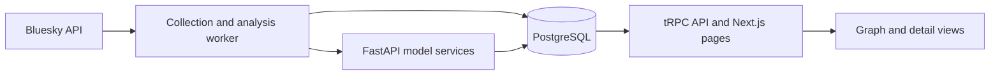

# Senka

Senka is a tool for inspecting Bluesky activity and the domains shared in posts. Built as a final-year Computer Science (Artificial Intelligence) project at Brunel University London, it combines a data-collection worker, Python model services and an interactive graph interface.

This repository contains the university project source. No hosted demo is provided.

## What it does

- Collects Bluesky profiles, posts, media references, links and follower relationships.
- Queues background jobs to analyse posts and domains, storing the results in PostgreSQL.
- Uses pretrained models to flag not-safe-for-work (NSFW) text and images, and score sentiment and topics in posts.
- Uses a trained classifier to identify potentially algorithmically generated domain names, alongside DNS, TLS, WHOIS and page-content checks.
- Displays users, posts and linked domains in a 3D graph, with relationship highlighting and separate profile/post detail pages.

## How the parts fit together



| Component | Role |
| --- | --- |
| [`apps/scheduler`](apps/scheduler) | TypeScript worker using Graphile Worker for profile/post collection and analysis jobs. |
| [`apps/models`](apps/models) | FastAPI endpoints for post and domain analysis, plus model training and inference code. |
| [`apps/nextjs`](apps/nextjs) | Next.js/React interface with a `react-force-graph-3d` graph and profile/post inspection pages. |
| [`packages/api`](packages/api) | tRPC queries that assemble graph data and expose stored records. |
| [`packages/db`](packages/db) | Shared Drizzle schema and PostgreSQL access. |

## Models and evaluation

The classifier detects domain names associated with domain-generation algorithms (DGAs). It combines hashed character 2–5-grams with domain length, digit ratio and Shannon entropy, using a scikit-learn `SGDClassifier` with logistic loss and streaming training. The [training notebook](apps/models/app/models/gda/notebooks/dga-detector.ipynb) and [inference code](apps/models/app/models/gda/eval.py) show the implementation. The directory is named `gda` in the original source.

Post analysis integrates existing Hugging Face models for text/image classification and sentiment, alongside zero-shot topic classification and keyword extraction. These models were not trained as part of Senka; the project work connects them to collection, storage, background processing and inspection. See the [text](apps/models/app/models/post_analyzer/services/classify_text.py) and [image](apps/models/app/models/post_analyzer/services/classify_image.py) pipelines.

The [dataset-building code](apps/models/app/models/gda/training/dataset.py) combines an existing train/test split with a random row split, without enforcing separation by domain family. The evaluation notebook selects decision thresholds on its reported test set. Independent, family-disjoint validation remains outstanding. The interface's domain “trust score” is a rule-based aggregate, not a calibrated probability that a site is safe.

## Development entry points

A fresh end-to-end installation has not been verified; the commands below are the project's existing development entry points.

The manifests specify Node.js **22.10 or later**, **pnpm 9.15.4**, and **Python 3.12 or later** with **uv**. The system also needs PostgreSQL, Bluesky credentials and access to the model artifacts downloaded by the Python service.

Install the JavaScript workspace with `pnpm install` and the Python dependencies with `uv sync` inside `apps/models`. Configuration is split across the [root environment example](.env.example), [scheduler environment schema](apps/scheduler/src/env.ts), [web environment schema](apps/nextjs/src/env.ts), [authentication environment schema](packages/auth/env.ts) and [model database connection](apps/models/app/common/db.py). The application schema is in [`packages/db/src/schema.ts`](packages/db/src/schema.ts); Graphile Worker uses PostgreSQL for its job queue.

After configuring the services and database, the existing development commands are:

```sh
# Run each service in a separate terminal from the repository root.
pnpm --filter @senka/models dev
pnpm --filter @senka/scheduler dev
pnpm dev:next
```

The worker calls the model API at `http://127.0.0.1:8000`.

## Credits and licence

Project by [Akbarshokh Sobirov](https://github.com/asobirov). The monorepo builds on [create-t3-turbo](https://github.com/t3-oss/create-t3-turbo), and the Python service began from a uv/FastAPI example. Existing attribution is retained in [LICENSE](LICENSE). Pretrained models and datasets retain their own licences and attribution requirements.
